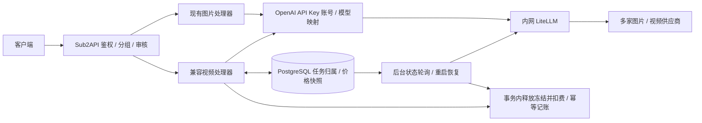

# LiteLLM 图片与视频网关

Sub2API 继续负责用户鉴权、分组、模型白名单、审核和计费。LiteLLM 作为仅内网可访问的上游，负责不同供应商的协议转换。本期覆盖图片和视频；歌曲/配乐生成不在本期范围，TTS 不等同音乐生成。



## 部署与账号

1. 应用数据库迁移 `250_compatible_video_tasks.sql`（正常启动的迁移机制会自动执行），备份与回滚方式沿用现有流程。新增任务表，不新增价格列。
2. 将 `deploy/litellm/.env.example` 复制为本地 `.env`，使用下文固定的 LiteLLM 1.110.0 构建及验证流程，并在生产设置不可变镜像摘要；配置实际供应商密钥。`config.yaml` 是示例模型，须按账户可用性、供应商模型生命周期和所选版本调整。代码未代替你购买/开通供应商权限。
3. 启动 `deploy/litellm/compose.yml`，将内部 TLS 反向代理与 Sub2API 容器接入 `sub2api-media` 网络。LiteLLM 不映射宿主机端口。生产通过现有反向代理提供受信任证书的内部 HTTPS 域名（如 `https://media-gateway.internal`），转发到 `http://litellm:4000`。Sub2API 开启 `security.url_allowlist.enabled` 时强制 HTTPS；在 `upstream_hosts` 中精确允许该域名，私网部署按现有出站策略配置 `allow_private_hosts`。仅本地开发且白名单已关闭、显式设置 `allow_insecure_http` 时才可直接使用 HTTP，不要为接入而关闭生产白名单。
4. 创建 **OpenAI / API Key** 账号：`base_url=https://media-gateway.internal`，`api_key` 填内部 LiteLLM key，显式勾选 **Video (LiteLLM / OpenAI)** 能力。能力名是 `video_generation`；普通 OpenAI/OAuth 账号不会自动获得该能力。配置严格的模型映射/白名单，例如 `video-veo -> video-veo`、`gpt-image-1 -> image-gpt`，避免把文本或原生生图请求路由到错误服务。
5. 将账号绑定 OpenAI 分组，开启现有生图/媒体生成权限。在分组视频定价添加模型别名与 480p/720p/768P/1080p/2K 每秒售价；480p/720p/1080p 也可填写分组默认价，768P/2K 必须为模型显式配置。支持独立视频倍率与用户分组倍率。没有匹配的显式价格时拒绝视频提交；价格 0 表示免费。图片继续使用原有图片定价。为复用现有图片模型校验，客户端使用已有支持的图片模型名（如 `gpt-image-1`），通过账号模型映射转成 LiteLLM 别名 `image-gpt`；不直接向图片入口提交任意别名。

LiteLLM 仅做协议转换。禁用自动重试/跨模型回退，避免超时后重复创建收费任务。扩展模型只需在 LiteLLM 配置和 Sub2API 模型/价格中添加，供应商不支持的参数和操作不承诺自动适配。

## Seedance 与 MiniMax 的统一接入

已核对并验证 **LiteLLM 1.110.0 发布包**包含 Volcengine/Seedance 和 MiniMax 的原生异步视频适配器。提供的 Dockerfile 固定此版本，构建时检查适配器导入；不依赖 main 分支，也不沿用本机旧的 1.106.0 镜像。Sub2API 的统一 `/v1/videos` 路由会把两者都送入 LiteLLM 的 `video_generation` 账号。

在 Sub2API 的 OpenAI API Key 账号中配置以下模型映射，并为左侧公开名称配置分组售价：

| 客户端 model | 账号映射 / LiteLLM model_name | 本期可配置清晰度 |
| --- | --- | --- |
| video-seedance | volcengine/doubao-seedance-2-0-260128 | 480P、720P、1080P |
| video-minimax-h3 | minimax/MiniMax-H3 | 768P、2K |
| video-minimax-h3-max | minimax/MiniMax-H3-Max | 480P、768P |

以上清晰度范围按固定版本的适配器与内置模型目录校验；**H3-Max 不按 H3 的 2K 档位接入**。账号映射右侧和 LiteLLM 别名必须保留 `volcengine/` 或 `minimax/` 前缀，网关据此在冻结余额前检查清晰度，不能改成无供应商前缀的任意别名。

这三个入口使用同一请求结构：`model`、`prompt`、`seconds`、`size`、`resolution`。`resolution` 是生成质量与计费档位；`size` 用于确定画面比例，不承诺逐像素输出。网关将 Seedance 和 MiniMax 档位转换成供应商需要的原生值，避免使用供应商默认档位。

```sh
curl https://api.example.com/v1/videos \
  -H 'Authorization: Bearer sk-SUB2API_KEY' \
  -H 'Content-Type: application/json' \
  -d '{"model":"video-seedance","prompt":"海浪拍打礁石","seconds":5,"size":"1280x720","resolution":"720p"}'

curl https://api.example.com/v1/videos \
  -H 'Authorization: Bearer sk-SUB2API_KEY' \
  -H 'Content-Type: application/json' \
  -d '{"model":"video-minimax-h3","prompt":"海浪拍打礁石","seconds":5,"size":"1280x720","resolution":"768p"}'
```

Seedance 和 MiniMax 必须显式指定 `resolution`。其他兼容模型暂沿用 `size` 推导计费档位，不接收独立 `resolution`，避免未经验证的上游忽略该字段。原生 `duration`、`parameters`、`extra_body`、`content`、多参考素材和自定义上游地址/密钥等字段均不透传，防止覆盖账务字段或绕过媒体审核。支持的可选字段为 `input_reference`（单张图片 URL 或 multipart 文件）、`seed`、`watermark`、`generate_audio`、`camera_fixed`、`negative_prompt`、`user`；是否可用由对应模型校验。歌曲/配乐生成与参考视频输入不在本期范围。

### 构建与验证网关镜像

```sh
cd deploy/litellm
cp .env.example .env
# 编辑 .env：填内部网关密钥、供应商密钥；本地 LITELLM_IMAGE 可填下方标签。
docker build -t sub2api-litellm:1.110.0-media .
# 使用真实代理和供应商 stub，断网容器内验证，无需真实密钥，不产生供应商费用。
docker run --rm --network none --entrypoint python \
  sub2api-litellm:1.110.0-media /opt/media/verify_contract.py
# 生产将已测镜像推送至自己的仓库，用 digest 设置 LITELLM_IMAGE。
docker compose --env-file .env -f compose.yml config --quiet
docker compose --env-file .env -f compose.yml up -d
```

也可用 `compose.build.yml` 构建覆盖文件。Compose 只暴露内网 4000 端口并检查存活状态；Sub2API 侧仍按前文配置内部 TLS 域名、模型映射和权限。`ARK_API_KEY`、`ARK_API_BASE`、`MINIMAX_API_KEY`、`MINIMAX_API_BASE` 已在环境模板与 Compose 中接线。删除未启用的模型条目，并为启用的供应商填写实际密钥。

## API

```sh
curl https://api.example.com/v1/videos \
  -H 'Authorization: Bearer sk-SUB2API_KEY' \
  -H 'Content-Type: application/json' \
  -d '{"model":"video-veo","prompt":"Sunlight on ocean waves","seconds":"8","size":"1280x720"}'
```

`POST /v1/videos/generations` 是创建别名，内部统一发送 LiteLLM `POST /v1/videos`。接受 JSON 和 multipart（`input_reference` 文件）。为防止供应商默认值导致错计费，必须显式指定 `seconds`（1–600 整数）与 `size`（无显式 resolution 时短边 480/720/1080），不套用 Grok 15 秒上限；实际模型可能限制更窄并返回校验错误。

成功返回 `id=mvid_...`，`Location: /v1/videos/{id}`。使用**同一 API Key、同一分组**查询或下载：

```text
GET /v1/videos/{id}
GET /v1/videos/{id}/content
```

不带 `/v1` 的现有别名也可用。公开任务 ID 与 LiteLLM 原始 ID 分离；状态和内容始终回到提交账号，不走其他账号补位。内容下载前查询状态并触发幂等结算；未完成或失败任务返回 409，不转发下载。已冻结余额或额度耗尽不阻止查询本人的任务；禁用 Key/用户和 IP 限制继续生效。编辑/续写不在兼容视频接口范围，原有 Grok/Seedance 路径保留。

图片沿用 `/v1/images/generations`、`/v1/images/edits` 与现有异步图片 API，只有上游账号指向 LiteLLM；异步图片依旧要求原有对象存储配置。

## 账务、恢复和运维

- 创建前持久化用户、Key、分组、上游账号、请求时长/分辨率及价格/倍率快照；余额模式事务内冻结完整预估费用。请求结束不释放任务冻结，管理员改价不影响已接受任务。
- `completed`（兼容 `succeeded`/`success`/`done`）时在同一个 PostgreSQL 事务中认领账务幂等键、解冻并按**请求时长**扣费，更新 Key/账号计数，标记任务已结算。订阅模式沿用订阅结算，不冻结钱包；simple 模式不冻结/扣钱包，开启 Key 窗口计费时仅记录该窗口。
- `failed`/`cancelled`/`canceled` 只释放冻结。重复查询、并发查询和多个服务实例不会重复扣费/退款。状态中的供应商实际时长不覆盖请求计费快照。
- 后台每 15 秒轮询最多 100 个待结算任务，不依赖客户端持续查询。单个上游查询限时 30 秒，数据库记录支持服务重启恢复。任务不因 Redis TTL 丢失归属；任务表应纳入备份，不可按短 TTL 自动删除未结算记录。
- **不确定提交**：网络超时、上游 5xx、缺少任务 ID 或接受后持久化失败，不能证明未生成。返回 502 与本地 ID，保留冻结并标记 `submission_unknown`；任务请求体会持久化，后台 worker 在冷却后使用同一个 `Idempotency-Key` 重试提交，成功后绑定上游 ID。上游或中转站必须正确支持该幂等键；不支持时仍需对照供应商日志人工确认，禁止直接退款后再次创建。
- 删除账号前会检查未结算的视频/音乐任务并拒绝删除；永久上游 404、长期不可达和不确定提交仍需要运维处理。监控两张任务表中 `NOT settled` 的数量、最老创建时间、空 `upstream_id`，以及 `service.compatible_video`/`service.replicate_music` 的 reconciliation 日志。

灰度时先配置一个分组、一个视频模型和一个图片模型，验证实际费用与请求时长相符，再逐个打开其他模型。回滚先关闭新提交能力；保留 LiteLLM 与任务轮询直到所有任务结算/释放，避免卸载造成冻结余额遗留。

## 验证

自动化测试使用真实 LiteLLM HTTP 代理连接本地供应商 stub，验证 LiteLLM 的 Seedance、H3、H3-Max 适配器协议、状态与下载；Go HTTP stub/本地测试服务器验证 Sub2API 网关权限、账务与错误分支，PostgreSQL 集成测试验证冻结/结算事务。实际供应商冒烟测试需要部署环境密钥：每个启用模型至少执行一次视频生成及查询/下载、一次图片生成；有图片编辑能力的模型再测试编辑。未跑真实付费请求不能视为上游模型可用性验证。

可复现的本地验证命令：

```sh
cd backend
# 本次接口、账务、Grok/Seedance 与图片回归。
go test -tags=unit ./internal/service ./internal/handler ./internal/server/routes ./internal/server/middleware \
  -run 'Compatible|Images|Grok.*(Video|Media)|Seedance|UsageBilling|VideoModel|VideoPricing|VideoBilling|OpenAIEndpoint|IsAsyncImageTaskRead' -count=1 -timeout=120s
# Docker harness 创建独立 PostgreSQL / Redis，运行全部迁移。
go test -tags=integration ./internal/repository \
  -run 'TestCompatibleVideo|TestMigrationsRunner_IsIdempotent_AndSchemaIsUpToDate' -count=1
cd ../frontend
./node_modules/.bin/vue-tsc --noEmit
./node_modules/.bin/vitest run src/views/admin/__tests__/groupsVideoModelPricing.spec.ts \
  src/views/admin/__tests__/groupsImagePricing.spec.ts src/i18n/__tests__/localeKeyCompleteness.spec.ts
```

2026-11-18 本地结果：上述相关回归、PostgreSQL 18 事务/迁移集成测试、前端类型检查、16 项定价/i18n 测试和 176 项账号管理测试通过，服务端入口编译与 Compose 配置校验通过。未使用真实供应商密钥，未执行付费端到端生成。全量 service 单测在低并发复核时超过 180 秒总限时，不能据此宣称全量通过；首次默认并发运行还出现 `TestInflightEstimate_AccountMappingNoDBAndBoundedMemory` 的堆内存阈值断言失败。该堆内存测试单独重跑通过；相关实现不修改该测试或估算逻辑。

本次追加验证：真实 LiteLLM 1.110.0 HTTP 代理在 `--network none` 容器中连接 loopback 供应商 stub，Seedance 720p、H3 768P/2K、H3-Max 480P/768P 的创建、状态转换、内容下载及失败/取消状态均通过，且每次创建仅提交一次。该验证确认协议转换，不证明供应商账号权限或实际出片质量。当前工作区未发现 Ark/MiniMax 凭据配置，未修改现有运行服务、未执行真实付费生成；正式启用还需部署镜像、配置账号/售价并执行真实供应商冒烟。
